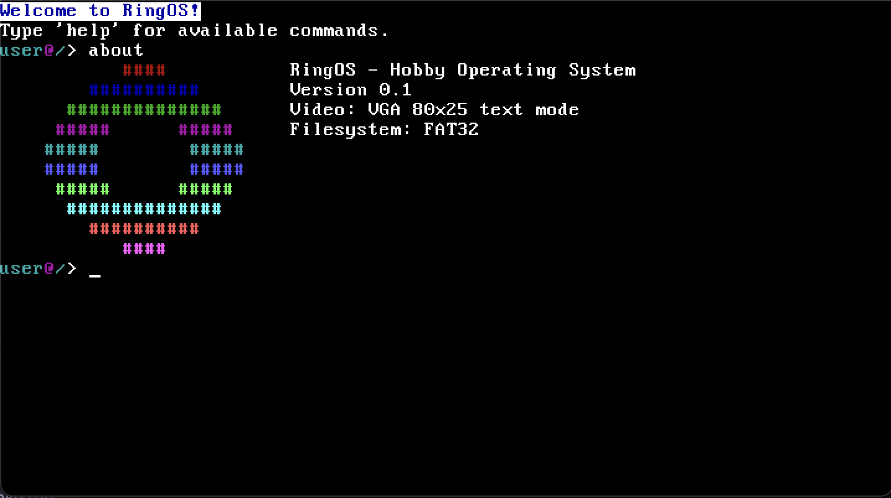

# RingOS

A hobby Operating System written in C.

## Features

 - [X] Fat32 filesystem
 - [X] Custom LibC (**Very** limited and by far not POSIX compliant, but soon)
 - [X] System interrupts
 - [X] Custom bootloader (No Grub Club)

## WIP
- [ ] Modern graphics
- [ ] Executable binary support
- [ ] Custom JVM
- [ ] Multiple users
- [ ] Multiple architectures

# Building and Running
## Linux and MacOS(x86)
```console
$ ./buildrun-linux.sh
```

## Silicone MacOS(M1>)
```console
$ ./buildrun-silicone.sh
```

## Build Your Own Programs (C SDK)

RingOS now includes a tiny user-space C library (`clib`) and a compiler script
for building flat binaries that `exec` can run.

### 1. Build a sample app

```console
$ ./tools/build-userprog.sh programs/hello.c filesystem/userland/apps/HELLO.BIN
```

### 2. Rebuild OS + disk image

```console
$ make
```

### 3. Run and execute inside RingOS shell

```text
cd APPS
exec HELLO.BIN
```

### Create your own app

Create a new file like `programs/myapp.c`:

```c
#include "clib.h"

int main(void) {
	clib_puts("My custom RingOS app!\n");
	return 0;
}
```

Build it:

```console
$ ./tools/build-userprog.sh programs/myapp.c filesystem/userland/apps/MYAPP.BIN
```

Then run `make`, boot, and use `exec MYAPP.BIN`.
